  

  <a href="https://sushmitadasari.github.io/Sushmitadasari/">Portfolio</a>
  &nbsp;·&nbsp;
  <a href="https://www.linkedin.com/in/sushmita-dasari-227a40284/">LinkedIn</a>
  &nbsp;·&nbsp;
  <a href="https://leetcode.com/u/sushmita_dasari/">LeetCode</a>
  &nbsp;·&nbsp;
  <a href="https://github.com/Sushmitadasari">GitHub</a>

---

### About

I’m **Khizer Ahmad**, an AI/ML undergraduate and full-stack developer interested in building intelligent systems that work as complete products — from the underlying logic and APIs to the experience people use.

I’m pursuing a **B.Tech in Artificial Intelligence and Machine Learning at Aditya Engineering College**, with a **CGPA of 9.10**. Java is my primary language for problem-solving; I use Python for machine-learning work and enjoy exploring the connection between AI, system design and product engineering.

### Recognition & credentials

- **Flipkart GRiD 7.0** — National Semi-Finalist.
- **Myntra WeForShe HackerRamp 2026** — Top 100 Team, with the StarCloset submission.

**Credentials and training**  
AWS Certified AI Practitioner · AWS Academy Graduate — Cloud Foundations · MongoDB Certified Associate Developer · GitHub Foundations · Oracle Java and Database Foundations · NPTEL Database Management Systems, Fundamentals of Artificial Intelligence and Deep Learning · Cisco HTML, CSS, JavaScript and Python Essentials · Pearson IT Specialist — HTML and CSS · Microsoft Azure hands-on training (Udemy).

[View credential details and professional background](https://sushmitadasari.github.io/Sushmitadasari/#experience)

### Selected work

#### StarCloset — Myntra Bharat AI

A fashion-shopping assistant built around an explainable, rule-based recommendation pipeline. It understands natural-language and Hinglish occasion prompts, scores and diversifies products, and explains why an item was recommended. Gemini is optional; the deterministic recommendation flow works without it.

**Stack:** React 19 · TypeScript · Go · PostgreSQL · Redis · optional Gemini  
[Repository](https://github.com/Sushmitadasari/weforshe-starcloset)

#### Payment Gateway System

A full-stack payment gateway with merchant authentication, order APIs, hosted UPI and card checkout, a processing-to-success/failed payment lifecycle, and a merchant dashboard. The services are containerised with Docker Compose.

**Stack:** Node.js · Express.js · PostgreSQL · React · Docker · Docker Compose  
[Repository](https://github.com/Sushmitadasari/Payment-gateway-system-Project)

#### Multi-Tenant SaaS Platform

A project-governance application built on a shared-database architecture with tenant-scoped data access, JWT authentication, role-based authorization and subscription-aware controls.

**Stack:** React · Node.js · Express.js · PostgreSQL · Sequelize · Docker Compose  
[Repository](https://github.com/Sushmitadasari/Multi-Tenant-SaaS-Platform)

### Technical toolkit

| Area | Technologies |
|---|---|
| **Languages** | Java · Python · C · C++ · TypeScript · JavaScript |
| **AI & machine learning** | Machine Learning · Deep Learning · NLP · LLM integration |
| **Frontend** | React · HTML · CSS |
| **Backend & APIs** | Node.js · Express.js · REST APIs · Microservices · JWT authentication |
| **Data** | PostgreSQL · MongoDB · MySQL · Redis |
| **Infrastructure & tools** | Docker · Docker Compose · AWS · Git · GitHub · Postman |
| **Computer science** | Data Structures & Algorithms · OOP · DBMS · Operating Systems · Computer Networks · Multithreading |

### GitHub contributions

  

Public GitHub contribution-calendar data · refreshed automatically by GitHub Actions.

### Connect

  <a href="https://sushmitadasari.github.io/Sushmitadasari/">Portfolio</a>
  &nbsp;·&nbsp;
  <a href="https://videoportfolio-kohl.vercel.app/">Video portfolio</a>
  &nbsp;·&nbsp;
  <a href="https://www.linkedin.com/in/sushmita-dasari-227a40284/">LinkedIn</a>
  &nbsp;·&nbsp;
  <a href="https://leetcode.com/u/sushmita_dasari/">LeetCode</a>
  &nbsp;·&nbsp;
  <a href="mailto:sushmitadasari17@gmail.com">Email</a>

  

